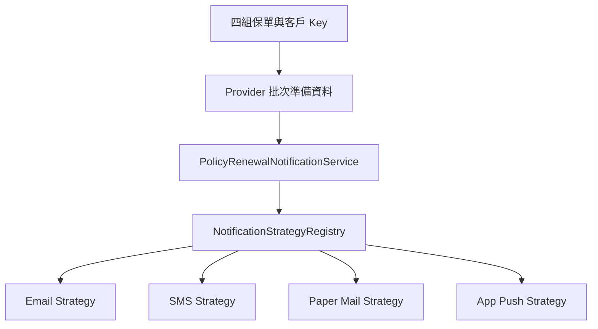

# Strategy Pattern：保單續期通知 DEMO

## 1. 專案目的

本專案是公司內部約 20 分鐘技術分享使用的 Java DEMO，以「保單續期通知」呈現 Strategy Pattern 如何隔離不同通知管道的變動。範例刻意不包含 Controller、REST API、資料庫或真實通知串接，讓討論聚焦在物件責任與測試方式。

## 2. 案例背景

系統依保戶偏好，透過 Email、SMS、紙本郵寄或 App Push 發送續期提醒。四種管道做的是同一件事──通知保戶續期──但各自有不同的聯絡資料檢核、內容格式與外部整合點。

## 3. 輸入與資料來源

`PolicyRenewalBatchRequest` 只接受保單號碼與客戶證號。通知方式、客戶姓名、到期日、保費及聯絡資料皆由 Provider 取得，因為通知方式是保戶偏好或系統設定，不應由呼叫端任意指定。

處理流程如下：

```text
PolicyRenewalBatchRequest
        ↓
轉換 PolicyCustomerKey
        ↓
Provider 批次取得續期與通知資料
        ↓
依原始 Request 順序逐筆處理
        ↓
Registry 根據 Provider 回傳的 NotificationType 取得 Strategy
        ↓
Strategy 執行檢核、內容組裝與 Gateway 呼叫
        ↓
回傳 PolicyRenewalBatchResult
```

## 4. 完整資料流



## 5. 元件責任

| 元件 | 負責什麼 | 不負責什麼 |
|---|---|---|
| Request | 表達要處理的保單號碼與客戶證號 | 指定通知方式或攜帶聯絡資料 |
| Provider | 一次批次取得續期資料、聯絡資料與通知偏好 | 發送通知、決定單筆失敗是否中止整批 |
| Service | 驗證輸入、協調批次流程、維持順序、處理部分成功與統計 | 實作各通知管道細節、直接呼叫 Gateway |
| Registry | 建立 `NotificationType → NotificationStrategy` 對應並提早檢查重複註冊 | 查資料、組內容、呼叫 Gateway 或建立結果 |
| Strategy | 單一通知方式的檢核、內容組裝與 Gateway 呼叫 | 查詢保單、選擇自己、控制整批流程 |
| Gateway | 隔離 Email、SMS、列印與 App Push 等外部系統邊界 | 表達策略選擇或批次決策 |

Strategy 表達可替換的業務處理方式；Gateway 表達外部系統邊界。不是所有 interface 都是 Strategy。本 DEMO 的 Gateway 全部是無副作用 Fake，不會真的寄信、發簡訊、建立郵務資料或發送推播。

## 6. if-else 版本

`LegacyNotificationService` 是可運作的早期版本／概念對照。if-else 本身不是錯誤；少量且穩定的分支很適合保留直接判斷。當通知管道增加且各分支持續獨立修改時，同一個 Service 會逐漸同時承擔通知方式選擇、聯絡資料檢核、訊息格式化、Gateway 呼叫與結果組裝，維護及多人協作成本才開始上升。

## 7. Strategy 版本

- Strategy 隔離每個通知管道的變動原因。
- Registry 隔離策略選擇，重複註冊會在建立 Registry 時立即失敗。
- Service 保持批次流程穩定，單筆可預期失敗不影響後續保單。
- Gateway 隔離外部系統，讓 Strategy 單元測試不需連接真實服務。

## 8. 效能說明

**Strategy Pattern 不是效能最佳化。**

if-else、switch 與 Map Registry 的分派成本通常可忽略；真正較大的效能因素是 DB、API、網路與檔案 I/O。本案例讓 Provider 使用單次批次查詢，是為了避免正式替換成 DB 後產生 N+1 查詢，這才是較實際的效能考量。Strategy 的主要價值是降低開發、修改、測試與多人協作成本。

## 9. 執行環境

- Java 21
- Maven（專案附 Maven Wrapper）
- Spring Boot 3.5.6
- JUnit 5
- AssertJ
- Mockito

## 10. 執行方法

已安裝 Maven：

```bash
mvn test
```

使用 Maven Wrapper：

```bash
./mvnw test
```

Windows：

```powershell
mvnw.cmd test
```

只執行主要 Demo：

```bash
mvn -Dtest=PolicyRenewalNotificationDemoTest#shouldSendRenewalNotificationsUsingCustomerPreferences test
```

Wrapper 對應指令可將開頭的 `mvn` 改為 `./mvnw`；Windows 則使用 `mvnw.cmd`。

## 11. Demo 預期結果

```text
PL20260001 → EMAIL      → SUCCESS
PL20260002 → SMS        → SUCCESS
PL20260003 → PAPER_MAIL → SUCCESS
PL20260004 → APP_PUSH   → SUCCESS
```

Demo Console 會顯示保單號碼、遮蔽後客戶證號、通知方式、遮蔽後目的地、處理結果、說明與批次統計，不輸出完整個資或 `processedAt`。

## 12. 如何新增通知方式

以虛構的 `LINE_MESSAGE` 為例：

1. 在 `NotificationType` 新增 `LINE_MESSAGE`。
2. 新增代表外部整合邊界的 Gateway。
3. 新增實作 `NotificationStrategy` 的 Strategy。
4. 為新 Strategy 與相關流程新增測試。
5. 主 Service 不需要加入新的 if-else。

## 13. 什麼情況不適合 Strategy

- 只有一兩個簡單且穩定的條件。
- 不同分支並不是同一種能力。
- 每個實作的輸入與輸出完全不同。
- 只是單一方法內的小判斷。
- 套用後反而產生大量沒有獨立責任的類別。

## 14. Demo 閱讀順序

1. `LegacyNotificationService`
2. `FakePolicyRenewalNotificationProvider`
3. `PolicyRenewalNotificationService`
4. `NotificationStrategyRegistry`
5. `NotificationStrategy`
6. `SmsNotificationStrategy`
7. `PolicyRenewalNotificationDemoTest`

## 15. 專案結構

```text
strategy-policy-notification-demo
├── pom.xml
├── mvnw / mvnw.cmd
├── src/main/java/com/example/policynotification
│   ├── PolicyNotificationApplication.java
│   ├── comparison    # 可運作的 if-else 對照
│   ├── exception     # 少量、明確的通知處理例外
│   ├── gateway       # 外部系統邊界與 Fake configuration
│   ├── model         # Request、Provider 資料與 Result
│   ├── provider      # 批次資料來源
│   ├── service       # 應用流程協調
│   ├── strategy      # Strategy、Registry 與四種實作
│   └── support       # 個資遮蔽
└── src/test/java/com/example/policynotification
    ├── PolicyRenewalNotificationDemoTest.java
    ├── model
    ├── provider
    ├── service
    ├── strategy
    └── support
```

## 16. 假資料與安全聲明

以下資料全部是為 DEMO 建立的純假資料，不代表任何真實保戶、保單或聯絡資料：

| policyNumber | customerId | notificationType | customerName | paymentDueDate | premiumAmount | 假聯絡資料 |
|---|---|---|---|---|---:|---|
| PL20260001 | A123456789 | EMAIL | 王小明 | 2026-09-30 | 12000 | xiaoming.wang@example.com |
| PL20260002 | B223456781 | SMS | 陳小華 | 2026-10-15 | 8600 | 0912345678 |
| PL20260003 | C123456789 | PAPER_MAIL | 林怡君 | 2026-11-05 | 23500 | 台北市內湖區範例路100號 |
| PL20260004 | D223456781 | APP_PUSH | 張志豪 | 2026-12-20 | 15800 | demo-device-token-0004 |

正式程式與 Demo Console 都不輸出完整客戶證號或完整通知目的地；測試會驗證遮蔽結果與異常輸入安全性。
