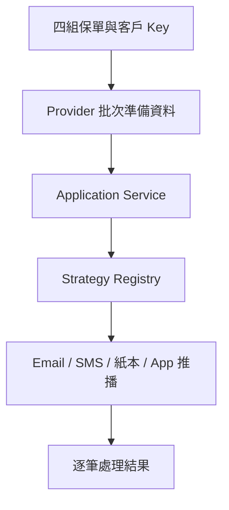

# Strategy Pattern：保單續期通知範例

這是一個適合約 20 分鐘公司內部技術分享的 Java 範例。呼叫端只提供四組「保單號碼＋客戶證號」，Provider 模擬查回續期資料與保戶偏好的通知方式，再由 Registry 選出 Email、SMS、紙本或 App 推播 Strategy。

所有姓名、證號、保單號碼與聯絡資料均為純假資料。

## 為什麼使用 Strategy

Strategy 的目標不是提升運算效能，也不是把所有 `if-else` 消滅，而是隔離會獨立變動的通知算法。新增或修改一種通知方式時，主流程不必同時承擔該管道的檢核、格式化與 Gateway 呼叫。



## 元件責任

| 元件 | 責任 | 不負責 |
|---|---|---|
| Provider | 批次取得續期與通知資料 | 發送通知 |
| Service | 控制批次流程與部分成功 | 各管道細節 |
| Registry | 依類型找到 Strategy | 執行通知規則 |
| Strategy | 單一管道的檢核、格式與發送 | 查詢保單資料 |
| Gateway | 隔離外部服務 | 選擇通知方式 |

## 環境

- Java 21
- Maven 3.9+
- Spring Boot 3.5.6

## 執行

執行全部測試：

```bash
mvn test
```

只執行展示測試：

```bash
mvn -Dtest=PolicyRenewalNotificationDemoTest#shouldSendRenewalNotificationsUsingCustomerPreferences test
```

展示測試會印出四筆分流結果。Console 輸出只用於說明，Assertion 才是測試成功與否的判斷依據。

專案也包含 GitHub Actions；推送到 `main` 或建立 Pull Request 時會自動執行 `mvn verify`。

## Demo 閱讀順序

1. `comparison/LegacyNotificationService`
2. `provider/FakePolicyRenewalNotificationProvider`
3. `service/PolicyRenewalNotificationService`
4. `strategy/NotificationStrategyRegistry`
5. `strategy/SmsNotificationStrategy`
6. `PolicyRenewalNotificationDemoTest`

## 設計取捨

- Provider 採批次 `findAll`，避免替換成 DB 後出現 N+1 查詢。
- Request 不接受通知方式，因為通知偏好應來自系統資料。
- 單筆失敗不終止整批，這是 Service 的流程決策，不是 Strategy 的責任。
- 四種 Gateway 使用無副作用 Fake，範例不連接任何真實通知服務。
- `LegacyNotificationService` 並非錯誤寫法；它用來呈現當分支持續成長時，主類別會累積多種修改原因。

## 專案結構

```text
src/main/java/com/example/policynotification
├── comparison    舊式 if-else 對照
├── exception     範例需要的少量例外
├── gateway       外部通知邊界與 Fake Bean
├── model         輸入、Provider 資料與結果
├── provider      批次資料取得
├── service       批次流程協調
├── strategy      Strategy、Registry 與四種實作
└── support       個資遮蔽工具
```
